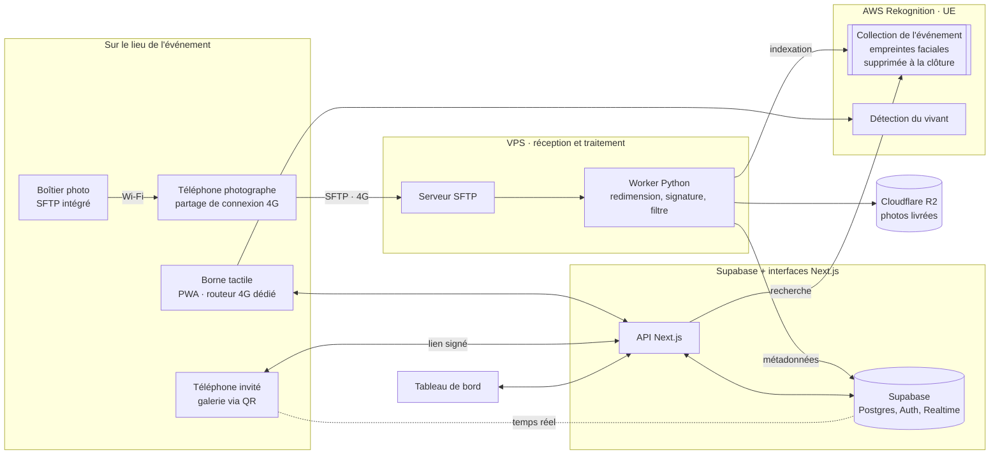
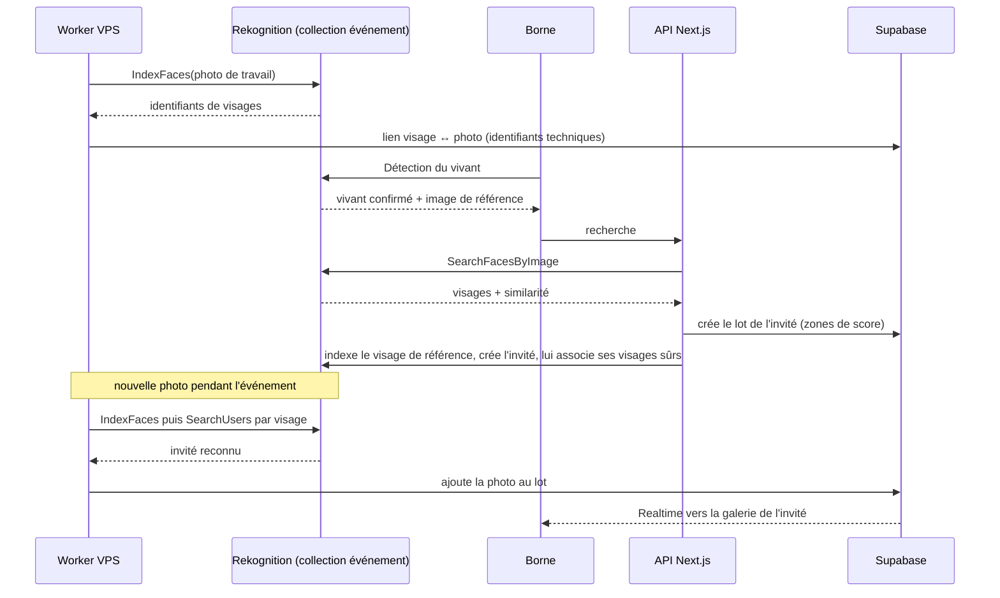
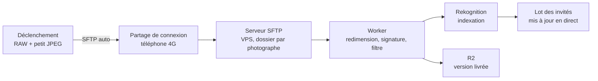
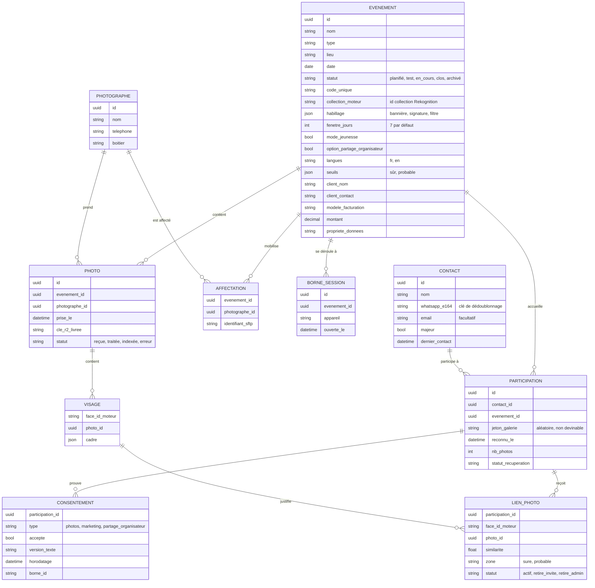
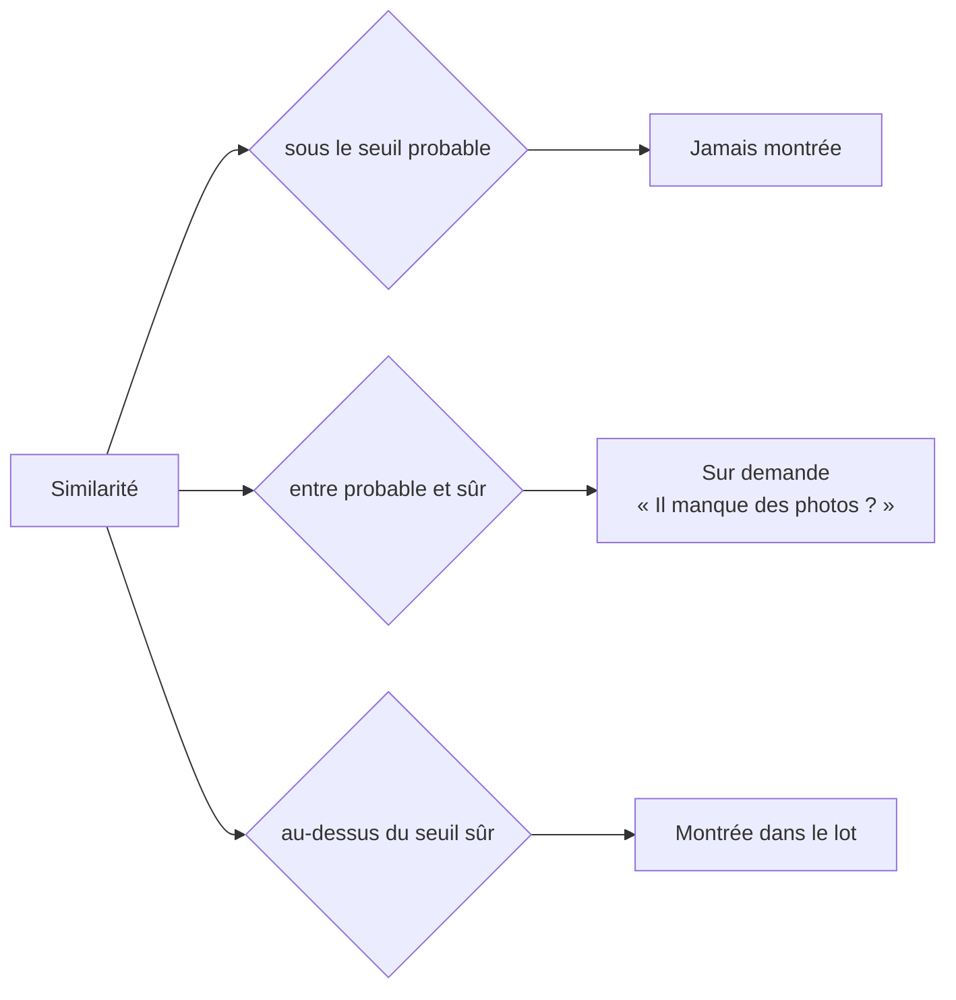
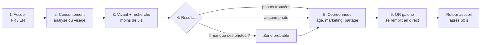
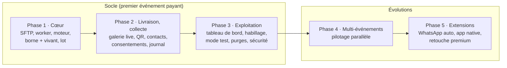
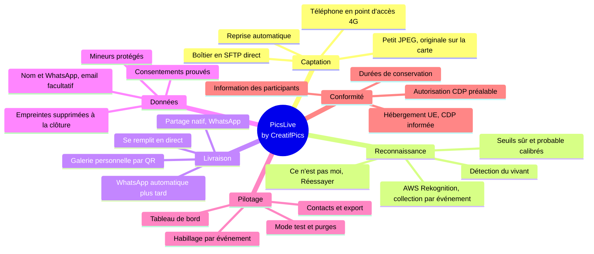

# Cahier des charges : PicsLive, by CreatifPics

Système de récupération de photos d'événement par reconnaissance faciale.
Document de référence pour le développement complet.

| Porteur | Stack | Version | Contact |
|---|---|---|---|
| CreatifPics | Next.js, Supabase, Python, AWS Rekognition | 2.1 · Novembre 2026 | contact@creatifpics.sn, +221 77 185 86 35 |

> Les schémas sont écrits en Mermaid : ils s'affichent sur GitHub, dans VS Code (extension Mermaid) et sont lisibles par Claude Code.

---

## Sommaire

0. Journal de révision (v2.0 vers v2.1, puis v1.1 vers v2.0)
1. Présentation du projet
2. Architecture technique
3. Moteur de reconnaissance faciale
4. Hébergement et coûts
5. Captation et envoi des photos
6. Modèle de données
7. Règles de reconnaissance
8. Cas d'erreur et règles de comportement
9. Contacts, consentements et mineurs
10. Habillage et rendu des photos
11. Workflows complets
12. Livraison des photos
13. Interfaces et prototypes
14. Sécurité
15. Matériel et préparation
16. Conformité et cycle de vie des données
17. Modèle commercial et marché
18. Critères de réussite et plan de test
19. Développement et découpage
20. Feuille de route
21. Schéma récapitulatif
22. Décisions, points à valider, points ouverts

---

## 0. Journal de révision

### 0.1 De la v2.0 à la v2.1 (novembre 2026)

Mise à jour après les décisions prises depuis le 21 octobre : hébergement, langues, borne, coûts, concurrence et calendrier.

| # | Sujet | v2.0 | v2.1 | Raison |
|---|---|---|---|---|
| 1 | Hébergement | Vercel Pro et Supabase Pro en production | **Supabase gratuit** avec garde-fous ; **interfaces Next.js sur le VPS** en production ; Vercel gratuit en développement seulement | Choix du porteur : coût fixe sous 10 000 XOF par mois. Vercel gratuit interdit l'usage commercial, d'où les interfaces sur le VPS. |
| 2 | Langues | Français et anglais, troisième langue prévue plus tard | **Français et anglais seulement** | Décision du porteur. |
| 3 | Borne V1 | Tablette Android 11 pouces | **iPad existant** (10,9 ou 11 pouces, caméra avant au centre en paysage) sur pied antivol ; tablette Android en alternative | Matériel déjà acquis, compatible avec la détection du vivant d'AWS. |
| 4 | Coûts | Estimations | **Prix relevés le 24 octobre 2026**, liens d'achat dans la fiche des coûts | Chiffrage réel. |
| 5 | Calendrier | JOJ en prospection, premiers événements payants en décembre | **Feuille de route recommandée** : autorisation CDP, 3 événements tests avec un outil existant, décision, puis construction | Les JOJ ont ouvert le 31 octobre ; le marché existe déjà (section 17.2) : il faut d'abord vérifier que les organisateurs paient. |
| 6 | Outil des tests | Non traité | **Nommé dans le dossier CDP**, de préférence hébergé en Europe | Il traite les visages des invités : son pays d'hébergement relève de l'article 49. |
| 7 | Marché | Non traité | **Analyse de la concurrence** (section 17.2) | Nataal et MedIA Finder proposent déjà la recherche par selfie au Sénégal. |
| 8 | Identité | Non traité | **Logo « viseur » et système de design PicsLive** (Jost, bleu nuit, or) pour toutes les interfaces | Logo retenu (piste A). |

### 0.2 De la v1.1 à la v2.0 (octobre 2026)

Relecture complète de la v1.1 avec vérification des points techniques et juridiques qui n'avaient pas été sourcés. Voici ce qui change et pourquoi.

| # | Sujet | v1.1 | v2.0 | Raison |
|---|---|---|---|---|
| 1 | Moteur facial | InsightFace sur VPS | **AWS Rekognition** (V1), InsightFace sous licence commerciale en plan B | Les modèles pré-entraînés d'InsightFace sont réservés à un usage de recherche non commercial. Le code est libre, pas les modèles. |
| 2 | Anti-fraude | Aucune | **Détection du vivant** (Rekognition Face Liveness) à la borne | Sans elle, n'importe qui peut présenter la photo d'une autre personne et récupérer toutes ses photos. |
| 3 | Captation | App fabricant + app FTP sur téléphone | **Envoi SFTP direct par le boîtier** via le partage de connexion du téléphone ; app FTP en repli | Le Canon R6 Mark II envoie en FTP, FTPS ou SFTP, automatiquement après chaque prise, avec reprise automatique. |
| 4 | Fichier envoyé | « Originale » sur le serveur | **JPEG de travail allégé** (2 à 4 Mo) ; l'originale reste sur la carte du photographe | Un JPEG pleine taille de 10 Mo sature la 4G et coûte cher en data. |
| 5 | Chiffrement | FTP | **SFTP ou FTPS obligatoire**, FTP en clair interdit | Le FTP transmet identifiants et photos en clair. |
| 6 | Base de données | PostgreSQL sur VPS + Socket.io | **Supabase** (Postgres, Auth, Realtime, RLS) ; aucune empreinte faciale dans Supabase | Une seule source de vérité, temps réel natif, stack maîtrisée. |
| 7 | Taille du VPS | PRO3 (8 vCPU dédiés) | **ECO2 ou ECO3 suffisent** (le calcul facial part chez AWS) | Le VPS ne fait plus que réception, redimensionnement, signature. |
| 8 | Hébergement web | Vercel gratuit | **Vercel Pro** et **Supabase Pro** en production | Le plan Hobby de Vercel interdit l'usage commercial ; Supabase gratuit met en pause les projets inactifs. |
| 9 | Cadre CDP | « Déclaration recommandée pour les institutionnels » | **Autorisation préalable obligatoire** avant tout déploiement | Loi 2008-12, article 20 : les traitements de données biométriques sont soumis à autorisation de la CDP. |
| 10 | Transfert hors Sénégal | Non traité | **Information de la CDP**, hébergement en Union européenne | Article 49 : transfert vers un pays tiers seulement s'il assure une protection suffisante, après information de la CDP. Le VPS et AWS sont en Europe. |
| 11 | Personnes photographiées non inscrites | Non traité | **Information obligatoire par l'organisateur** (affichage, invitation) | Tous les visages des photos sont indexés, y compris ceux de personnes qui ne passent jamais à la borne. |
| 12 | Mineurs | Non traité | **Marketing réservé aux 18 ans et plus**, mode « événement jeunesse » | Mariages, scolaires, JOJ : beaucoup de mineurs. |
| 13 | Partage à l'organisateur | « Si l'invité consent », sans case prévue | **Troisième case dédiée**, affichée seulement si l'option est vendue | Le consentement doit être spécifique et prouvable. |
| 14 | Preuve du consentement | Non traité | **Journal des consentements** (texte, version, horodatage, borne) | En cas de contrôle, il faut pouvoir prouver ce qui a été accepté. |
| 15 | Conservation des contacts | « Conservée » sans limite | **Photos seules : supprimés à la fin de la fenêtre + 30 jours** ; marketing : 3 ans après le dernier contact | Une durée de conservation est obligatoire. |
| 16 | Coordonnées obligatoires | Nom, WhatsApp, email | **Nom et WhatsApp obligatoires, email recommandé** | Minimisation des données. **Décision à valider par toi** (section 22). |
| 17 | « Aucune photo trouvée » | « Recevoir automatiquement sur WhatsApp » | **Lien de galerie personnel remis tout de suite, qui se remplit en direct** | La V1 n'a pas d'envoi WhatsApp automatique : la promesse était impossible à tenir. |
| 18 | Bouton galerie | « Recevoir sur WhatsApp » | **« Partager sur WhatsApp »** | En V1, c'est l'invité qui partage ; rien n'est envoyé automatiquement. |
| 19 | Écran de la borne | Photos en grand | **Vignettes seulement, galerie complète sur le téléphone**, retour à l'accueil après 60 s | Les personnes dans la file voyaient les photos de l'invité. |
| 20 | Seuils 75 % / 60 % | Présentés comme des pourcentages fixes | **Seuils de similarité calibrés** sur un jeu de test | Chaque moteur a sa propre échelle de score. |
| 21 | Plan de test | Absent | **Protocole de test** (précision, rappel, vitesse, charge) | Sans protocole, les critères de réussite sont invérifiables. |
| 22 | Sécurité | Absente | **Section dédiée** | Jetons de galerie, URL signées, 2FA admin, mode kiosque, sauvegardes. |
| 23 | Planning | JOJ comme cible de déploiement | **JOJ comme fenêtre de prospection**, premiers événements payants après autorisation CDP | JOJ dans 10 jours, autorisation CDP jusqu'à 2 mois, athlètes mineurs, marques olympiques protégées. |
| 24 | Langues | Non décidé | **Français et anglais** | Événements internationaux. |

---

## 1. Présentation du projet

PicsLive retrouve et livre automatiquement à chaque invité les photos sur lesquelles il apparaît. L'invité se présente à une borne, son visage est vérifié puis comparé aux photos de l'événement, et il récupère ses photos sur son téléphone après avoir laissé ses coordonnées.

PicsLive est l'innovation de CreatifPics : le produit a son propre nom, la marque mère en récolte la notoriété.

### Les quatre piliers

1. **Borne en libre-service** : reconnaissance faciale en direct, pendant l'événement.
2. **Galerie personnelle par QR** : l'invité récupère ou partage ses photos depuis son téléphone ; la galerie se remplit au fil de l'événement.
3. **Photographes synchronisés** : plusieurs photographes, un ou plusieurs événements en parallèle.
4. **Contacts qualifiés** : aucun invité anonyme, base marketing consentie et prouvable.

### Objectifs par acteur

- **Invité** : voir et récupérer ses photos en quelques secondes, sans effort.
- **Client organisateur** : une expérience moderne et, en option, une base de participants consentie.
- **Opérateur (CreatifPics)** : un service rentable, conforme, qui construit une base de contacts à chaque événement.

### Hors périmètre

Marque blanche, impression sur place, filtres façon photobooth, retouche beauté en direct.

---

## 2. Architecture technique

Architecture cloud. Chaque appareil sur le lieu utilise sa propre connexion 4G. Aucun réseau local à installer. Les photographes peuvent être dans la salle et la borne à la sortie : ils ne se parlent jamais directement.

Trois rôles bien séparés :

- **VPS** : reçoit les photos (SFTP), les redimensionne, appose signature et filtre, les envoie au stockage et au moteur facial.
- **AWS Rekognition (région UE)** : indexe les visages, vérifie le vivant, compare. Seul endroit où existent les empreintes faciales.
- **Supabase** : base de données métier, authentification, temps réel. **Interfaces Next.js** (borne, galerie, tableau de bord) servies par le VPS en production.

**Schéma 1 : architecture générale**

| Composant | Rôle | Choix retenu |
|---|---|---|
| Réception photos | Dépôt des fichiers des boîtiers | Serveur SFTP sur VPS (fournisseur local, facturé en XOF, machines en Europe) |
| Traitement image | Redimensionnement, signature, filtre identité | Worker Python (Pillow) sur le VPS |
| Reconnaissance | Indexation, comparaison, détection du vivant | AWS Rekognition, une collection par événement |
| Base de données | Événements, contacts, photos, liens, consentements | Supabase (Postgres + RLS) |
| Temps réel | Galerie qui se remplit en direct | Supabase Realtime |
| Stockage photos | Versions livrées, temporaires | Cloudflare R2 (zéro frais de sortie), URL signées |
| Interfaces | Borne, galerie, tableau de bord | Next.js sur le VPS en production (Vercel gratuit en développement seulement) |

---

## 3. Moteur de reconnaissance faciale

### 3.1 Pourquoi pas InsightFace en V1

Le code d'InsightFace est sous licence MIT, mais ses modèles pré-entraînés (buffalo_l et les autres) sont déclarés « disponibles pour la recherche non commerciale uniquement ». Les alternatives gratuites (SFace, YuNet d'OpenCV) ont des droits d'usage commercial non clarifiés sur leurs poids. Pour un service vendu, il faut des droits certains.

### 3.2 Choix V1 : AWS Rekognition

| Critère | AWS Rekognition |
|---|---|
| Droits commerciaux | Clairs (service payant à l'usage) |
| Cloisonnement | Une **collection par événement** ; supprimer la collection supprime toutes les empreintes |
| Visages flous | Filtre de qualité natif à l'indexation |
| Détection du vivant | Face Liveness, intégrable dans la borne web |
| Serveur | Aucun calcul lourd sur le VPS |
| Coût | 0,001 $ par image indexée ou recherche, 0,015 $ par vérification du vivant |

Estimation pour un événement de 5 000 photos et 500 invités : indexation 5 $, recherches et mises à jour en direct 10 à 15 $, vérifications du vivant 7,5 $. **Soit environ 15 000 à 18 000 XOF par événement**, à refacturer dans la prestation.

Réglages obligatoires :

- Région européenne (Irlande ou Francfort ; disponibilité de Face Liveness à confirmer à la création du compte).
- Activer la politique de désinscription des services IA d'AWS (les contenus ne servent pas à entraîner leurs modèles).
- Ne pas conserver l'image de référence de la détection du vivant : seul son vecteur est ajouté à la collection de l'événement (supprimée à la clôture).
- Intégration de la détection du vivant dans la borne via le composant web officiel d'AWS (Amplify, React), avec identifiants temporaires côté serveur.

### 3.3 Plan B : InsightFace sous licence commerciale

Si le volume ou le coût AWS le justifient, ou pour un fonctionnement hors ligne, acheter une licence commerciale des modèles InsightFace et faire tourner le moteur sur un VPS à CPU dédié (PRO3). **Le code de PicsLive passe par une interface « moteur facial » unique** (indexer, rechercher, supprimer) pour permettre ce changement sans réécriture.

### 3.4 Fonctionnement

---

## 4. Hébergement et coûts

### 4.1 Environnements

| Étape | Environnement | Coût mensuel |
|---|---|---|
| Développement | Poste local + Supabase et Vercel gratuits + compte AWS (offre gratuite 12 mois : 1 000 images par mois) | 0 XOF |
| Tests bout en bout | VPS ECO1 (SFTP + worker) | 3 500 XOF |
| Production PicsLive | VPS ECO2 ou ECO3, dédié uniquement à PicsLive | 4 900 à 8 900 XOF |
| Base de données | Supabase, offre gratuite (500 Mo, 2 projets actifs au plus) | 0 XOF |
| Interfaces | Next.js sur le VPS de production (Vercel interdit l'usage commercial en offre gratuite) | 0 XOF |
| Stockage | Cloudflare R2 (10 Go gratuits, puis environ 0,015 $ par Go) | 0 à quelques centaines XOF |
| Autres projets | VPS ECO1 séparé pour n8n, Hermes | 3 500 XOF |
| **Total fixe PicsLive** | | **environ 5 000 à 9 000 XOF par mois** |

Coûts par événement, à intégrer au devis : Rekognition (15 000 à 18 000 XOF pour 5 000 photos et 500 invités), data 4G des photographes et de la borne (11 000 à 12 500 XOF avec les pass Orange, section 5.4). Les crédits offerts à l'ouverture du compte AWS (jusqu'à 200 $) couvrent environ les 6 à 8 premiers événements de cette taille.

> **Garde-fous de l'offre gratuite Supabase :** la base se met en pause après 7 jours sans activité et n'a pas de sauvegarde automatique. Une tâche n8n l'interroge tous les 3 jours ; un export complet de la base part chaque nuit vers un stockage séparé.

> **Recommandation :** passer à Supabase Pro (environ 15 000 XOF par mois) dès le premier événement payant facturé avec PicsLive. Une perte de données sur un événement client coûterait bien plus que l'abonnement.

> **Si le PRO3 est déjà commandé :** il reste valable et laisse de la marge pour le plan B InsightFace. Inutile de changer.

> **Déploiement des interfaces :** Next.js tourne sur le VPS de production derrière un proxy HTTPS (Caddy ou Coolify). Héberger aussi Postgres sur le VPS reste possible plus tard, au prix de plus de maintenance ; pas avant que le produit soit stable.

> **Règle :** rien d'autre ne tourne sur le serveur qui fait tourner un événement client en direct.

### 4.2 À vérifier auprès de l'hébergeur

- Accès root complet, IPv4 dédiée.
- Localisation des machines (l'offre PRO mentionne « CPX22 », gamme Hetzner, donc a priori Allemagne ou Finlande) : à confirmer pour la déclaration de transfert à la CDP.
- Passage d'une offre à l'autre sans réinstallation.

> **Migration facile :** toutes les commandes d'installation du serveur sont consignées dans un script dès le premier VPS.

---

## 5. Captation et envoi des photos

### 5.1 Chaîne recommandée : SFTP direct depuis le boîtier

Le Canon R6 Mark II se connecte en Wi-Fi à un point d'accès et envoie chaque photo en FTP, FTPS ou SFTP, **automatiquement après chaque prise**, avec **reprise automatique** si la connexion tombe. Il peut n'envoyer que le JPEG quand il enregistre en RAW + JPEG, et choisir la taille de JPEG envoyée.

Le téléphone du photographe sert uniquement de **point d'accès 4G**. Aucune application à installer, et cela fonctionne avec un iPhone comme avec un Android.

**Schéma 2 : trajet d'une photo**

Réglages du boîtier :

- Enregistrement **RAW + JPEG petite taille** (S1 ou M selon le boîtier, environ 2 à 4 Mo).
- Transfert : **JPEG uniquement**, automatique après la prise.
- Protocole **SFTP**, identifiants propres à chaque photographe (saisis une fois dans le boîtier) ; le serveur range ses photos dans l'événement auquel il est affecté à ce moment-là.

### 5.2 Chaîne de repli (boîtier sans FTP)

App du fabricant (Canon Camera Connect, Sony Creators' App, Nikon SnapBridge) en transfert automatique vers le téléphone, puis app d'envoi SFTP qui surveille le dossier de réception. **Android uniquement** : iOS ne permet pas la surveillance de dossier en arrière-plan.

### 5.3 App photographe native

Ne fait plus partie du socle. Elle reste une évolution (compte, session, compteurs, branding), construite autour de la bibliothèque d'envoi gotev si le besoin se confirme.

| Projet | Lien | Licence | Usage |
|---|---|---|---|
| gotev/android-upload-service | https://github.com/gotev/android-upload-service | Apache 2.0 | Socle si app native : envoi en arrière-plan, reprise automatique |
| Module FTP gotev | https://github.com/gotev/android-upload-service/blob/master/uploadservice-ftp/README.md | Apache 2.0 | Exemple d'envoi FTP |
| officially-aman/FTP | https://github.com/officially-aman/FTP | MIT | Exemple d'app complète à étudier |
| mtotschnig/SendWithFtp | https://github.com/mtotschnig/SendWithFtp | GPL v3 | À éviter : imposerait de publier le code |

### 5.4 Volume de données

Un photographe qui envoie 400 photos par heure à 3 Mo consomme environ 1,2 Go par heure (environ 3 Mbit/s en continu, supportable en 4G). **Prévoir 5 à 8 Go de data par photographe pour 5 heures**, une batterie externe pour le téléphone (le partage de connexion vide la batterie), et intégrer ce coût au devis.

---

## 6. Modèle de données

Les empreintes faciales n'existent que dans la collection Rekognition de l'événement. Supabase ne stocke que des identifiants techniques de visage, inutilisables seuls.

**Schéma 3 : entités principales (Supabase)**

- **Contact unique** par personne, dédoublonné par numéro WhatsApp normalisé (format international E.164).
- **Consentements par participation** : un invité peut accepter le marketing à un événement et le refuser à un autre.
- **Pas de copie de l'originale** sur le serveur : l'originale reste sur la carte du photographe (utile pour l'album premium).
- **Cloisonnement** : identifiant d'événement partout, RLS Supabase par événement pour les comptes non administrateurs.
- **Visages de référence des invités** : indexés dans la collection avec un identifiant externe distinct, exclus des résultats de recherche des autres invités.
- **Compteurs** (vues SQL) : photos reçues, invités reconnus, photos livrées, taux de consentement, corrections « ce n'est pas moi ».

---

## 7. Règles de reconnaissance

Chaque correspondance renvoie une **similarité** propre au moteur. Deux seuils découpent trois zones. Les valeurs sont **calibrées sur un jeu de test** (section 18) avant le premier événement, puis ajustables par événement depuis le tableau de bord.

**Schéma 4 : mode strict avec filet de sécurité**

| Zone | Seuil indicatif de départ (Rekognition) | Comportement |
|---|---|---|
| Sûre | 95 et plus | Montrée directement |
| Probable | 85 à 95 | Montrée seulement via « Il manque des photos ? » |
| Incertaine | moins de 85 | Jamais montrée |

- **« Ce n'est pas moi »** retire la photo du lot, instantanément, sans confirmation ; le visage est dissocié de l'invité.
- **Visages flous ou de dos** : écartés par le filtre de qualité à l'indexation.
- **Boucle d'amélioration** : le taux de « ce n'est pas moi » est suivi ; au-delà de 2 % des photos montrées, le seuil sûr est relevé.

---

## 8. Cas d'erreur et règles de comportement

| Situation | Comportement attendu |
|---|---|
| Aucune photo trouvée | Message neutre : « Nous n'avons pas encore de photos de vous. Votre galerie personnelle se remplira au fil de l'événement. » L'invité laisse ses coordonnées et **reçoit tout de suite son QR de galerie**, qui se remplit en direct. Bouton **Réessayer**. |
| Détection du vivant échouée | « Nous n'avons pas pu vérifier, réessayez face à la caméra, sans lunettes de soleil. » Après 3 échecs : appel de l'assistant. |
| « Ce n'est pas moi » | Retrait immédiat du lot. La photo reste disponible pour les autres personnes présentes dessus. |
| Retrait d'une photo de groupe | Alerte sur le tableau de bord, **validation humaine**, jamais de suppression automatique. |
| Coupure réseau côté photographe | Le boîtier conserve les photos et les renvoie automatiquement à la reconnexion. |
| Coupure réseau côté borne | « Connexion momentanément indisponible, merci de patienter. » Routeur 4G dédié + SIM de secours. |
| Moteur facial indisponible | Les photos restent en file sur le VPS et sont indexées au retour du service. La borne affiche un message d'attente. |
| Invité qui perd sa connexion | Galerie réaccessible par son lien pendant toute la fenêtre de récupération. |
| Coupure de courant | Borne et routeur sur batterie de secours. |

> **Principe :** une mauvaise connexion ralentit le service, elle ne le casse jamais. Rien ne se perd.

---

## 9. Contacts, consentements et mineurs

### 9.1 Coordonnées

| Champ | Statut | Usage |
|---|---|---|
| Nom | Obligatoire | Personnaliser la galerie |
| WhatsApp | Obligatoire | Identifiant unique, contact |
| Email | Recommandé, facultatif | Notification et marketing |

### 9.2 Consentements à la borne

| Case | Libellé | Statut |
|---|---|---|
| Photos | « J'accepte l'analyse de mon visage pour retrouver mes photos de cet événement. » | Obligatoire, avant le scan |
| Âge | « J'ai 18 ans ou plus. » | Conditionne l'affichage de la case marketing |
| Marketing | « J'accepte de recevoir des offres de CreatifPics. » | Facultative, jamais forcée |
| Partage | « J'accepte que mes coordonnées soient transmises à [organisateur]. » | Facultative, affichée seulement si l'option est vendue |

Chaque réponse est enregistrée dans le journal des consentements avec la version du texte, l'heure et la borne.

### 9.3 Mineurs

- Moins de 18 ans : photos uniquement, aucune case marketing ni partage, coordonnées supprimées à la fin de la fenêtre.
- **Mode « événement jeunesse »** (scolaires, compétitions de jeunes) : marketing et partage désactivés pour tout l'événement.

### 9.4 Personnes photographiées qui ne passent pas à la borne

Leurs visages sont indexés pour permettre la recherche des autres invités. Obligations contractuelles de l'organisateur :

- Affichage visible à l'entrée et mention dans l'invitation (traitement, finalité, durée, contact pour s'opposer).
- Possibilité de demander le retrait (formulaire sur la galerie ou auprès de l'assistant).

Ces visages disparaissent à la suppression de la collection, à la clôture de l'événement.

### 9.5 Base de contacts

- Base marketing : nom, contact, événement, consentements. Rien d'autre.
- Page Contacts : filtres par événement et par consentement, export CSV et Excel, taux de consentement.

---

## 10. Habillage et rendu des photos

Tout se configure **par événement**.

| Élément | Définition | Quand |
|---|---|---|
| Bannière | Écran d'accueil de la borne : visuel, titre, logo de l'événement | À la borne |
| Signature | Marquage des photos livrées : discrète (coin), bande sponsors, ou texte seul ; position et opacité réglables | En direct, par le worker |
| Filtre identité | Ambiance couleur légère : Signature maison, Chaleureux, Froid, Neutre ; intensité réglable, désactivable | En direct, par le worker |
| Retouche beauté | Peau, teint, via outil spécialisé (Evoto, Aftershoot ou Retouch4me) sur les originales des cartes | Premium, après l'événement |

> L'indexation faciale se fait sur l'image **avant** filtre et signature, pour ne pas dégrader la reconnaissance.

---

## 11. Workflows complets

### 11.1 Invité à la borne

**Schéma 5 : parcours invité**

1. **Accueil** : bannière de l'événement, choix de la langue.
2. **Consentement** à l'analyse du visage.
3. **Détection du vivant puis recherche.**
4. **Résultat** en vignettes : nombre de photos, « Il manque des photos ? », « Ce n'est pas moi ».
5. **Coordonnées** et consentements.
6. **QR de galerie personnelle**, puis retour automatique à l'accueil.

Interface grand public (gros boutons, peu de texte), assistant présent sur place.

### 11.2 Invité sur son téléphone

1. Il scanne le QR et ouvre sa galerie, à son nom ; elle s'actualise en direct.
2. Trois choix : **Partager sur WhatsApp**, **Tout enregistrer**, **Sélectionner**.
3. Le partage passe par le **menu natif du téléphone**, seule méthode fiable sur iPhone ; envois par lots de 20 photos.
4. Liens de demande de retrait et de désinscription en bas de page.

### 11.3 Photographe

1. Reçoit une fois ses identifiants SFTP personnels ; son affectation à l'événement se fait dans le tableau de bord.
2. Règle son boîtier : RAW + petit JPEG, envoi JPEG automatique, SFTP.
3. Active le partage de connexion de son téléphone, connecte le boîtier.
4. Fait une photo test : elle apparaît sur le tableau de bord.
5. Shoote normalement ; le tableau de bord suit son débit.

### 11.4 Opérateur (tableau de bord)

1. **Préparation** : événement, client, habillage, langues, mode jeunesse, options ; affectation des photographes (un photographe ne peut être affecté qu'à un événement à la fois).
2. **Mode test** : check-list (envoi, indexation, vivant, recherche, galerie, signature), puis effacement des données de test et de la collection de test.
3. **Direct** : vue multi-événements, état des photographes, alertes de retrait, taux de corrections.
4. **Contacts** : consultation, filtres, export.
5. **Clôture** : suppression de la collection Rekognition, puis purge des photos à la fin de la fenêtre, puis suppression des contacts sans consentement marketing.

---

## 12. Livraison des photos

| Étape | Mode | Détail |
|---|---|---|
| V1 | Galerie personnelle via QR | L'invité partage ou enregistre lui-même. Email de notification facultatif quand de nouvelles photos arrivent. |
| Évolution | Envoi automatique WhatsApp | API WhatsApp Business officielle ; l'invité initie la conversation via un QR click-to-WhatsApp (fenêtre gratuite de 24 h). |

> **À exclure :** les solutions non officielles qui pilotent WhatsApp Web (risque de bannissement du numéro).

---

## 13. Interfaces et prototypes

| Interface | Utilisateur | Technologie | Prototype |
|---|---|---|---|
| Borne invité | Invité, écran tactile | PWA en mode kiosque | PicsLive_Borne_Invite.html |
| Galerie invité | Invité, téléphone | PWA | PicsLive_Galerie_Invite.html |
| Tableau de bord | Opérateur | PWA | PicsLive_Tableau_de_bord.html |
| App photographe | Photographe | Évolution, non requise en V1 | PicsLive_App_Photographe.html |
| Landing page | Prospects | Web | PicsLive_Landing.html |
| Présentations | Clients | A4 imprimable | PicsLive_Presentation_Commerciale.html, PicsLive_Presentation_Projet.html |

Identité : toutes les interfaces suivent le système de design PicsLive (logo « viseur », Jost, bleu nuit #132f4c, or #c08a3e, blanc cassé #fdfbf7, icônes au trait de 2 px, aucun emoji). Langues : français et anglais.

Écarts à corriger dans les prototypes existants : bouton « Recevoir sur WhatsApp » à renommer « Partager sur WhatsApp » ; case « 18 ans ou plus » et case de partage à ajouter sur la borne ; étape « vérification du vivant » à ajouter ; section JOJ de la landing à retravailler (section 20).

---

## 14. Sécurité

| Sujet | Règle |
|---|---|
| Transferts | SFTP uniquement, identifiants par photographe ; dépôt refusé hors d'une affectation active ; compte désactivable à tout moment |
| Galerie | Jeton aléatoire non devinable dans l'URL, valable pendant la fenêtre de récupération |
| Photos | Accès par URL signées à durée courte, jamais de lien public permanent |
| Base | RLS Supabase par événement ; clés AWS et R2 uniquement côté serveur |
| Administration | Authentification Supabase avec double facteur pour les comptes opérateur |
| Borne | Navigateur en mode kiosque, sortie protégée par code, aucune donnée stockée localement |
| Abus | Limite de recherches par borne et par minute ; détection du vivant obligatoire |
| Sauvegardes | Sauvegarde quotidienne Supabase ; aucune sauvegarde des collections faciales |
| Traces | Journal des actions sensibles (exports, retraits, suppressions) |

---

## 15. Matériel et préparation

| Élément | Spécification | Budget indicatif |
|---|---|---|
| Borne V1 | iPad existant 10,9 ou 11 pouces (caméra avant au centre en paysage, modèles depuis 2022) sur pied au sol antivol, ou support de table posé sur une table haute ; anneau lumineux 14 pouces sur trépied | 30 400 à 118 500 FCFA (iPad déjà acquis) |
| Borne V1, alternative | Tablette Android 11 pouces ou plus, même équipement | 80 000 à 200 000 FCFA |
| Borne pro | Tactile 21,5" sur pied, caméra 1080p accessible au navigateur (WebRTC), LED, sans imprimante (Alibaba : Shenzhen Kingsun, Ebayar, Reyeah). Délai Chine vers Dakar : plusieurs semaines | 250 000 à 600 000 FCFA |
| Routeur 4G | Dédié à la borne (Huawei WiFi 3 ou TP-Link M7200), SIM Orange + SIM Yas | environ 40 000 FCFA |
| Batterie de secours | Station d'énergie (EcoFlow River 2, 256 Wh), seulement s'il n'y a pas de prise près de la borne | environ 295 000 FCFA |
| Batteries des photographes | 4 batteries externes 20 000 mAh pour le partage de connexion | environ 47 000 FCFA |
| Boîtiers (si parc propre) | Canon R6 Mark II (environ 1 800 $ reconditionné) + RF 50 mm f/1.8 (environ 190 $). Privilégier les boîtiers à envoi FTP intégré | Environ 2 000 $ par kit |

> **Recrutement :** démarrer avec des photographes équipés de boîtiers à FTP intégré. Constituer un parc propre une fois l'activité validée.

> **iPad en borne :** Accès guidé activé (l'invité ne peut pas quitter PicsLive), verrouillage automatique sur « Jamais », branché sur secteur pendant tout l'événement. Le pied antivol du commerce (AboveTEK) n'accepte que les iPad de 10,9 et 11 pouces : vérifier le modèle avant l'achat. Détail des prix et liens d'achat : fiche des coûts du 24 octobre 2026.

Repères d'équipe : 1 à 2 photographes pour un petit événement, 3 à 4 pour un moyen, 5 à 8 pour un grand.

### Check-list de préparation

- [ ] Affichage d'information posé à l'entrée par l'organisateur.
- [ ] Couverture 4G testée à l'emplacement exact de la borne ; SIM de secours.
- [ ] Batteries chargées : borne, routeur, boîtiers, téléphones des photographes (batterie externe).
- [ ] Accès SFTP testés pour chaque photographe (photo test visible au tableau de bord).
- [ ] Mode test validé, données de test effacées.
- [ ] Assistant présent à la borne, briefé sur le retrait et les mineurs.

---

## 16. Conformité et cycle de vie des données

### 16.1 Cadre sénégalais (loi 2008-12)

- **Article 20 : autorisation préalable de la CDP** pour tout traitement comportant des données biométriques. À obtenir **avant le premier événement**, pas seulement pour les clients institutionnels.
- **Article 49 : transfert hors du Sénégal** (VPS et AWS en Europe) autorisé vers un pays assurant une protection suffisante, **après information de la CDP**.
- Responsable de traitement : CreatifPics. Contrat avec chaque organisateur précisant les rôles, l'information des participants et la propriété des données.

> Ce cadre est issu du texte de loi ; il doit être validé par un juriste avant le dépôt du dossier CDP.

**Schéma 6 : durée de vie des données**

```mermaid
gantt
  title Durée de vie de chaque type de donnée
  dateFormat X
  axisFormat %s
  section Test
  Effacées avant ouverture          :done, 0, 1
  section Empreintes (Rekognition)
  Pendant l'événement uniquement    :crit, 1, 2
  section Photos livrées
  Fenêtre de récupération 7 jours   :active, 1, 9
  Rétention payante (option)        : 9, 12
  section Contacts sans marketing
  Fenêtre + 30 jours                : 1, 13
  section Contacts marketing
  3 ans après le dernier contact    : 1, 16
```

| Donnée | Durée de vie |
|---|---|
| Données de test | Effacées avant le vrai démarrage |
| Empreintes faciales | Collection supprimée à la clôture de l'événement |
| Photos livrées (R2) | 7 jours par défaut, ajustable ; option payante 1 mois, 3 mois, 1 an |
| Contacts sans consentement marketing | Supprimés 30 jours après la fin de la fenêtre |
| Contacts avec consentement marketing | 3 ans après le dernier contact, désinscription à tout moment |
| Journal des consentements | Conservé tant que le contact existe |

---

## 17. Modèle commercial et marché

### 17.1 Offres

| Offre | Contenu | Cible |
|---|---|---|
| Location par événement | Borne, photographes, reconnaissance, livraison | Organisateurs, particuliers |
| Forfait multi-sites | Plusieurs événements en parallèle, cloisonnés | Institutions, fédérations |
| Base de participants | Contacts ayant coché la case partage, remis à l'organisateur | Forums, sponsors |
| Album retouché premium | Photos en direct, album retouché depuis les originales le lendemain | Mariages, galas |
| Rétention prolongée | Galerie maintenue au-delà de 7 jours | Tous |

> **Propriété des données (option C) :** CreatifPics est propriétaire de la base par défaut. Le partage au client est une option payante, inscrite au contrat, limitée aux invités ayant coché la case de partage.

Le devis intègre les coûts variables : moteur facial, data 4G, rémunération des photographes, assistant.

La grille tarifaire reste à fixer. Recommandation : tester deux niveaux de prix sur les premiers événements avant de publier une grille.

### 17.2 Marché et concurrence (recherche du 23 octobre 2026)

La recherche de photos par selfie existe déjà, y compris au Sénégal. Ce qui n'existe pas, d'après cette recherche, c'est l'ensemble livré sur place : borne avec vérification du vivant, galerie qui se remplit pendant la soirée, habillage de l'événement et des sponsors, autorisation CDP et photographes fournis.

| Service | Origine | Ce qu'il fait | Borne | Direct | WhatsApp |
|---|---|---|---|---|---|
| Nataal | Sénégal | Place de marché pour photographes : selfie, achat par Wave ou Orange Money | Non | Non | Contact seul |
| MedIA Finder | Burkina Faso, Sénégal | Reconnaissance faciale pour mariages et cérémonies | Non précisé | Non précisé | Non précisé |
| maphoto.ma | Maroc | QR code et selfie, surtout mariages | Non | Non | Annoncé |
| AccioPix | Inde | Selfie envoyé sur WhatsApp, photos reçues dans la conversation, environ 1,3 XOF par photo | Non | Non | Oui |
| Premagic | Dubaï, Inde | Inscription par selfie, envoi en quelques minutes, publicité des sponsors | Non | En minutes | Oui |
| Tag Your Photo | États-Unis | iPad en poste de prise de vue, envoi pendant l'événement par SMS et email | Poste photo | Oui | Non |

> **Positionnement :** PicsLive se vend comme une option premium des reportages CreatifPics auprès des organisateurs, pas comme un logiciel face aux photographes. La technologie seule n'est pas un avantage : elle se vend 1 à 2 XOF la photo.

---

## 18. Critères de réussite et plan de test

### 18.1 Critères

| Critère | Cible |
|---|---|
| Vitesse | Moins de 5 s entre la fin de la détection du vivant et l'affichage |
| Précision | Moins de 2 % de photos d'une autre personne dans le lot principal |
| Rappel | Au moins 85 % des photos où l'invité est visible de face, en comptant la zone probable |
| Délai d'envoi | Moins de 1 min entre la prise et la disponibilité, en 4G correcte |
| Capacité | 5 000 photos et 500 invités par événement sans ralentissement |
| Disponibilité | Toute la durée de l'événement, tolérance aux coupures |

### 18.2 Protocole de test

1. **Jeu de test annoté** : 500 photos d'un événement réel (avec consentement écrit des personnes), 30 personnes identifiées, carnations variées, lumière de soirée.
2. **Calibration** : mesurer précision et rappel pour plusieurs seuils, retenir les seuils sûr et probable.
3. **Charge** : 4 boîtiers en envoi simultané pendant 1 heure, 50 recherches à la borne.
4. **Terrain** : un petit événement réel avant toute prestation payante.
5. **Fraude** : présenter une photo imprimée et un écran à la borne ; la détection du vivant doit les refuser.

---

## 19. Développement et découpage

Développement en interne avec Claude Code. Web en Next.js et Supabase, servi par le VPS en production ; worker en Python sur le VPS ; moteur derrière une interface unique.

Premier jalon : « une photo arrive par SFTP, un visage est indexé, une recherche à la borne la retrouve, la galerie s'affiche ».

**Schéma 7 : ordre de développement**

| Phase | Contenu |
|---|---|
| 1. Cœur | Serveur SFTP, worker (redimension, indexation), interface moteur, borne avec détection du vivant, recherche, lot |
| 2. Livraison et collecte | Galerie temps réel, QR, coordonnées, consentements, journal, base de contacts |
| 3. Exploitation | Tableau de bord, habillage, mode test, purges automatiques, sécurité, français et anglais |
| 4. Multi-événements | Plusieurs événements pilotés en parallèle (le cloisonnement est en base dès la phase 1) |
| 5. Extensions | WhatsApp automatique, app photographe native, retouche premium |

---

## 20. Feuille de route

Nous sommes le 3 novembre 2026. Les JOJ ont ouvert le 31 octobre : ils ne sont plus une cible. Trois contraintes restent valables pour tous les grands événements :

1. **Autorisation CDP** : obligatoire avant tout traitement biométrique, y compris avec un outil existant ; réponse de la CDP jusqu'à deux mois.
2. **Mineurs** : compétitions de jeunes, scolaires, mariages ; mode « événement jeunesse » (section 9.3).
3. **Marques protégées** : « JOJ », « Dakar 2026 » et les anneaux olympiques ne s'utilisent pas dans la communication commerciale sans autorisation ; la landing page parle de « grands événements internationaux ».

### 20.1 Feuille de route recommandée (dates indicatives)

| Période | Objectif |
|---|---|
| Novembre 2026 | Choisir un juriste ; déposer le dossier d'autorisation CDP (en y nommant l'outil des tests) ; recherche d'antériorité de la marque à l'OAPI ; prospection : 3 organisateurs engagés pour janvier et février |
| Novembre à décembre | Facultatif, sans données réelles : maquettes de la borne et de la galerie, prototype du premier jalon (section 19) |
| Janvier 2027 | Dès l'autorisation CDP : 3 événements tests avec un outil existant, vendus en option « Photos en direct » de CreatifPics |
| Mi-février | **Décision** selon la règle ci-dessous ; dépôt de la marque à l'OAPI si oui |
| Février à avril | Si oui : phases 1 à 3 (section 19), jeu de test et calibration, événement test gratuit |
| Mai 2027 | Premiers événements PicsLive payants |

> **Règle de décision :** construire PicsLive si au moins 2 organisateurs sur 3 paient l'option, si au moins un la redemande, et si une part nette des invités récupère effectivement ses photos. Sinon, rester sur l'outil existant et réinvestir le temps ailleurs.

> **Priorité :** un système fiable, conforme et testé plutôt qu'un lancement précipité. Un incident biométrique pendant un événement médiatisé coûterait plus cher que d'arriver quelques mois plus tard.

---

## 21. Schéma récapitulatif

**Schéma 8 : PicsLive en une vue**

---

## 22. Décisions, points à valider, points ouverts

### 22.1 Décisions actées

| Sujet | Décision |
|---|---|
| Nom | PicsLive, by CreatifPics |
| Architecture | Cloud, chaque appareil sur sa propre 4G |
| Moteur | AWS Rekognition en V1 derrière une interface unique ; InsightFace licence commerciale en plan B |
| Captation | SFTP direct depuis le boîtier ; app SFTP Android en repli ; app native en évolution |
| Hébergement | VPS ECO2 ou ECO3 dédié (interfaces Next.js, SFTP, worker), Supabase gratuit avec garde-fous, R2 ; Vercel gratuit en développement seulement ; ECO1 séparé pour les autres projets |
| Langues | Français et anglais |
| Borne V1 | iPad existant sur pied antivol, anneau lumineux, routeur 4G à deux cartes SIM |
| Identité | Logo « viseur » (piste A) et système de design PicsLive |
| Reconnaissance | Mode strict, seuils calibrés et ajustables, filet de sécurité, détection du vivant |
| Collecte | Aucun anonyme, consentements séparés et prouvés, mineurs protégés |
| Habillage | Bannière, signature, filtre identité par événement ; retouche beauté en premium |
| Livraison | Galerie personnelle temps réel, partage natif |
| Propriété | CreatifPics par défaut, partage client payant, limité aux invités consentants |
| Conformité | Autorisation CDP avant le premier événement, information des participants, durées de conservation |
| Opération | Mode test obligatoire, assistant à la borne, check-list |

### 22.2 À valider par toi

- **Email facultatif** au lieu d'obligatoire (recommandé pour la conformité ; si tu veux le garder obligatoire, il faut justifier son usage dans la livraison, par exemple l'envoi systématique du lien par email).
- **Rekognition plutôt qu'InsightFace** (dépendance à AWS contre droits commerciaux clairs et détection du vivant intégrée).
- **Tester avant de construire** : 3 événements avec un outil existant, puis décision selon la règle de la section 20.1 (recommandé).
- **Outil des tests** : le nommer dans le dossier CDP ; vérifier où AccioPix et Premagic hébergent les données avant de choisir (de préférence en Europe).
- **Passage à Supabase Pro** dès le premier événement PicsLive payant (recommandé).

### 22.3 Points ouverts

- Grille tarifaire par type d'événement.
- Juriste pour le dossier CDP et les modèles de contrat organisateur.
- Réponses de l'hébergeur : localisation, root, IPv4.
- Disponibilité de Face Liveness dans la région AWS retenue.
- Outil de retouche premium.
- Formulations exactes des textes d'interface, en français et en anglais.
- Modèle exact de l'iPad (Réglages, Général, Informations) avant l'achat du pied antivol.
- Honoraires du juriste et coût d'un éventuel mandataire pour le dépôt OAPI (taxe de 375 000 XOF par classe, 95 000 XOF la recherche d'antériorité, 600 000 XOF en forfait mandataire).

### Sources des vérifications

- Licence InsightFace (code MIT, modèles non commerciaux) : https://github.com/deepinsight/insightface/blob/master/python-package/README.md
- Droits des poids SFace non clarifiés : https://github.com/opencv/opencv_zoo/issues/313
- FTP, FTPS, SFTP sur le R6 Mark II : https://cam.start.canon/en/C012/manual/html/UG-07_Network_0070.html
- Tarifs Rekognition : https://aws.amazon.com/rekognition/pricing/
- Vercel Hobby, usage non commercial : https://vercel.com/docs/plans/hobby
- Offres Supabase : https://supabase.com/pricing
- Exigences de la détection du vivant AWS : https://docs.aws.amazon.com/rekognition/latest/dg/face-liveness-requirements.html
- Pass internet Orange Sénégal : https://www.orange.sn/pass-internet
- Dépôt de marque OAPI : https://www.yoon.africa/guide-pratique/comment-effectuer-un-depot-de-marque-oapi
- Procédure CDP : https://www.gaelconseil.com/cybersecurite/declaration-cdp-senegal/
- Concurrence : https://nataal.app/, https://photobox.tickets-place.net/, https://maphoto.ma/, https://acciopix.com/, https://premagic.com/, https://tagyourphoto.net/
- Loi 2008-12, articles 20 et 49 : https://www.wipo.int/wipolex/fr/legislation/details/6229

---

*PicsLive, by CreatifPics · Cahier des charges v2.1 · contact@creatifpics.sn · +221 77 185 86 35*
